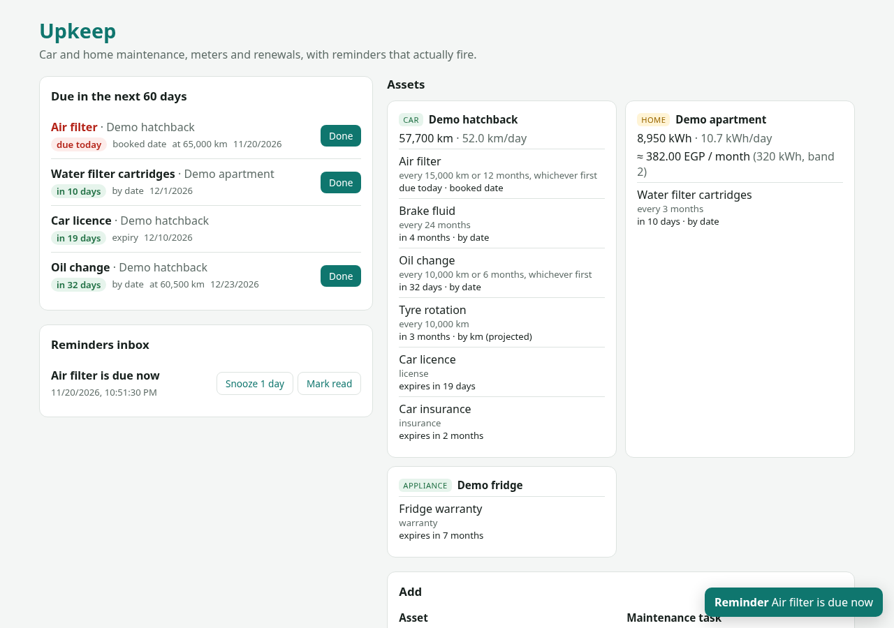
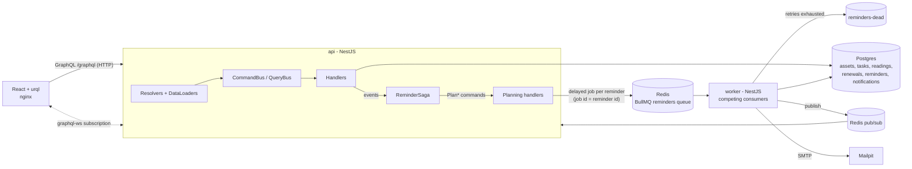

# Upkeep

Car and home upkeep with reminders that actually fire: maintenance intervals ("every 10 000 km or 6 months,
whichever comes first"), odometer and electricity meter readings, licence/insurance/warranty renewals, and
reminders 30, 7 and 1 days ahead plus at the due moment, delivered live in the browser (GraphQL subscription) and
by mail (a local Mailpit inbox in compose).

Record two odometer readings and Upkeep projects your km/day, so "every 10 000 km" becomes a date. Whichever side of
the rule comes first (time, distance, or a date you already know) decides when the oil change is due, and its
reminder jobs are replanned every time something moves that date.



## What it shows

- **GraphQL, code-first** (NestJS + Apollo Server 5): queries, mutations and **subscriptions over `graphql-ws`**,
  a typed React client generated from the schema (GraphQL Code Generator + urql), **DataLoader** against N+1.
- **CQRS with `@nestjs/cqrs`**: commands, queries, domain events, and a **saga** that turns "a due date may have
  moved" into "replan the reminder jobs".
- **BullMQ on Redis**: one **delayed job** per reminder, **retries with exponential backoff**, a **dead-letter
  queue**, a **repeatable** sweep job, and a **separate worker process** (competing consumers).
- **DDD-style domain in pure TypeScript**: the whichever-first interval rule, monotonic meter readings, usage
  projection, an Egyptian **banded electricity tariff** estimate, reminder planning and snooze, and **fuel-ups**
  with full-to-full consumption (L/100 km) and cost per km.
- **GraphQL hardening**: a validation rule rejects over-deep or over-costly queries (list fields weigh 10x,
  aliases count) before any resolver runs.
- **Resilient saga step**: a failed reminder (re)plan is retried with exponential backoff, and each retry first
  cancels what the failed try stored or enqueued.
- **Clean Architecture** with the dependency rule enforced by lint (`eslint-plugin-boundaries`).
- **Testcontainers** (Postgres + Redis) end-to-end test: mutation -> saga -> delayed job with the right delay ->
  worker fires -> notification stored -> subscription receives it; a failing job is retried then dead-lettered.

## Architecture



The main flow:

1. `addTask` stores the task and publishes `TaskDueChanged`; the mutation returns.
2. The saga sends `PlanTaskReminders`. Its handler computes the due moment (whichever first of months, projected
   km and a known date), plans reminders at 30/7/1/0 days before it (dropping past ones; an overdue item gets one
   right away), cancels the old plan and enqueues one delayed BullMQ job per reminder.
3. A new reading publishes `ReadingRecorded`; the saga replans every km-based task of that asset. A fuel-up is
   stored with its odometer reading in one transaction, so it moves due dates too.
4. When a job comes due, one worker runs `FireReminder`: only a SCHEDULED reminder fires; the notification row is
   unique per reminder, written in the same transaction that marks the reminder FIRED.
5. The worker publishes the notification on Redis; every API instance relays it to its `notificationAdded`
   subscribers; Mailpit receives a mail.
6. Failures retry with exponential backoff; after the last attempt the job is copied to `reminders-dead`.
   A repeatable sweep job re-enqueues SCHEDULED reminders that are past due and never fired.

| Path | What |
|---|---|
| `apps/api/src/domain` | Interval rule, maintenance task, readings and projection, tariff, reminder schedule, renewal (pure TS) |
| `apps/api/src/application` | Commands, queries, events, handlers, `ReminderSaga`, ports |
| `apps/api/src/infrastructure` | SQL repositories + migration (TypeORM), BullMQ queue and worker, Redis notification bus, SMTP mailer |
| `apps/api/src/presentation` | GraphQL types, resolvers, DataLoaders, subscription bridge, error mapping, health |
| `apps/api/src/main.ts`, `worker.ts` | The two processes (same image, different command) |
| `apps/api/schema.gql` | Printed SDL, input of the web codegen |
| `apps/web` | React + Vite + urql: due-soon list, reminders inbox (snooze, mark read), assets, forms, live toasts |
| `tests/integration` | Testcontainers Postgres + Redis tests |
| `docs/adr` | Architecture decision records |

## Quickstart

Needs Docker (or Podman with the Docker CLI).

```bash
cp .env.example .env                  # optional: every value has a local default
docker compose up -d --build --wait
./scripts/smoke.sh                    # health + car + oil change due in 1 minute -> reminder fired (bounded wait)
# web app (synthetic demo data with DEMO_DATA=true): http://localhost:8086
# Mailpit, the reminder mails:                     http://localhost:8025
docker compose up -d --scale worker=3 # competing consumers on one queue
docker compose down -v
```

GraphQL endpoint: http://localhost:3100/graphql (introspection on; use any GraphQL client).

```graphql
mutation {
  addTask(input: { assetId: "...", title: "Oil change", everyKm: 10000, everyMonths: 6, lastDoneKm: 52000 }) {
    id
    due { dueAt dueKm reason }
  }
}
subscription { notificationAdded { title message createdAt } }
```

### Local development

```bash
npm ci
npm run lint              # eslint (incl. layer boundaries) + prettier + web lint
npm run typecheck         # tsc strict for the API, the web app and the tests
npm test                  # unit tests (jest) + web tests (vitest)
npm run test:integration  # needs Docker: Testcontainers Postgres + Redis
npm run build
npm run schema -w @upkeep/api && npm run codegen   # after changing a resolver or a query (needs npm run build)
```

Run the API and the worker against compose's Postgres/Redis with `DATABASE_URL` and `REDIS_URL` set (see
`.env.example`): `npm run start -w @upkeep/api` and `npm run start:worker -w @upkeep/api`; the web dev server
(`npm run dev -w @upkeep/web`) proxies `/graphql` to `API_URL` (default `http://localhost:3000`).

## Interview talking points

- **The core rule** is a pure function: due = min(time side, distance side projected through km/day, known date).
  Without readings the distance side cannot become a date and time decides; a car that is not driven never becomes
  due by km. Month arithmetic clamps (31 Jan + 1 month = end of February).
- **Projection** uses readings from the last 90 days before the latest one and needs two readings at least a day
  apart. Readings must be monotonic against both neighbours, so back-filling an older reading is allowed.
- **Tariff** (Egyptian residential electricity): the month's total picks a band and only that band's slices apply,
  so going over a threshold loses the cheap slices. The table is configuration (`TARIFF_JSON`), not code.
- **GraphQL vs REST** (ADR 0002): the screen is a graph with a computed field (`Task.due`) that needs batched
  readings; DataLoader keeps it to one query per relation. Subscriptions scale across API replicas through Redis.
- **Delayed jobs vs polling** (ADR 0003): exact firing times, no table scans, idempotent by reminder id, retries
  with backoff, dead-lettering, and a sweep as the safety net for lost jobs.
- **CQRS and a saga** (ADR 0004): write handlers never touch the queue; the saga is the one place that reacts to
  "the due date may have moved". Honest trade-off: the query side is plain reads, so CQRS there is uniformity only.
- **Exactly-once effects over at-least-once delivery**: job id = reminder id, status check in the handler, unique
  notification per reminder, fire and mark FIRED in one transaction; fan-out and mail never fail the job.
- **Fuel economy, full-to-full**: only the stretch between two full tanks is honest; partial fill-ups inside it
  count, the first full tank and an open stretch at the end do not. Pure function in `domain/fuel.ts`, exposed as
  `Asset.fuelEconomy` (DataLoader-batched with `Asset.fuelUps`).
- **Retry where the saga can fail** (`application/retry.ts`): planning is "cancel old plan, store rows, enqueue
  jobs". A Redis blip between those steps used to leave rows without jobs until the sweep found them past due.
  Now the whole step is retried with backoff (`PLAN_ATTEMPTS`, `PLAN_BACKOFF_MS`); it is safe to repeat because
  `replacePlan` cancels the half-stored try and job id = reminder id. The wait goes through the clock port, so the
  test asserts the 100/200 ms backoff without sleeping. Trade-off vs an outbox: an API crash mid-retry still loses
  the plan; the sweep stays the safety net.
- **Query depth and cost limits** (`presentation/graphql/query-limits.ts`): a graphql-js `ValidationRule` walks the
  operation with fragments inlined and list-ness read from the schema: cost = 1 per field, a list field's selection
  x10. Defaults depth 8, cost 5000 (`GRAPHQL_MAX_DEPTH`, `GRAPHQL_MAX_COST`); a unit test checks that every
  operation of the web app stays under them, and a Testcontainers test checks the 400. Subscriptions over
  graphql-ws are not run through it (they are a single tiny field).
- **Testability**: handlers take ports (clock, ids, repositories, queue, bus, mailer); unit tests use in-memory fakes
  and a settable clock; the integration test runs the API and a worker in-process against real containers.

## Status

Working: the whole flow above, with 55 unit tests (domain, handlers, retry, query limits, fuel), 3 web tests and 7 Testcontainers
integration tests (including GraphQL e2e through supertest, a real graphql-ws subscription, two competing
workers firing each reminder exactly once, fuel economy through GraphQL, and the query cost limit).

Known gaps and next steps:

- No authentication or multi-user ownership: it is a single-user tool for now.
- Saga planning is retried in-process; a crash during the retries still loses the plan (next: an outbox).
- No persisted queries; the cost model is a static estimate (no per-field weights).
- Meter replacement/rollover is not modelled; fuel prices are plain numbers (no currency per fuel-up).
- No Azure/Bicep deployment files in this repo (compose only).

## Extracted from Lingo

Upkeep is extracted from **Lingo**, a private personal-assistant app, where car maintenance, car papers and home
meter readings lived as a few routes inside one Node server. This repository is a clean re-implementation with a
different architecture (GraphQL, CQRS, BullMQ), a fresh history and invented sample data only.

## License

[MIT](LICENSE)
